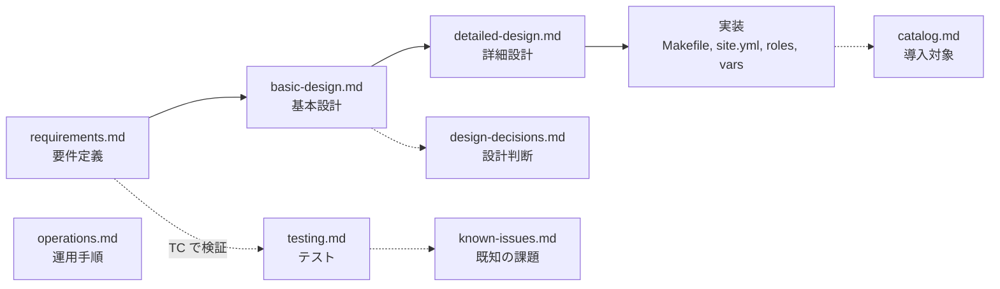

# ドキュメント

ansible-mac の要件・設計・運用をまとめたドキュメントです。リポジトリの入口は [README](../README.md) です。

## 文書一覧

| 文書 | 内容 |
| --- | --- |
| [requirements.md](requirements.md) | **要件定義書**。背景と目的、スコープ、機能 / 非機能要件、制約、受入基準、リスク |
| [basic-design.md](basic-design.md) | **基本設計書**。構成、実行モデル、変数とプロファイルの設計、権限・セキュリティ、外部インタフェース、CI/CD |
| [detailed-design.md](detailed-design.md) | **詳細設計書**。`Makefile`、変数一覧、role ごとの処理、スクリプト、GitHub Actions、コーディング規約 |
| [catalog.md](catalog.md) | 導入対象カタログ。formula / cask / App Store アプリ / MCP サーバ / 管理対象の設定 |
| [operations.md](operations.md) | 運用手順書。セットアップ、日常運用、版数の更新、変更の進め方、トラブルシューティング |
| [testing.md](testing.md) | テスト・品質。検証方針、CI、テストケース、冪等性の確認 |
| [design-decisions.md](design-decisions.md) | 設計判断記録（ADR）。なぜそうなっているか |
| [known-issues.md](known-issues.md) | 既知の課題と改善候補 |

## 目的別の読み方

| やりたいこと | 読む文書 |
| --- | --- |
| 初めて使う | [README](../README.md) → [operations.md](operations.md) の 1・2 章 |
| 仕組みを理解する | [basic-design.md](basic-design.md) → [detailed-design.md](detailed-design.md) |
| 何が入るかを知る | [catalog.md](catalog.md) |
| 目的やスコープを確認する | [requirements.md](requirements.md) |
| パッケージや role を変更する | [operations.md](operations.md) の 3・5 章 → [detailed-design.md](detailed-design.md) → [testing.md](testing.md) |
| 困ったとき | [operations.md](operations.md) の 6 章 → [known-issues.md](known-issues.md) |
| なぜこうなっているかを知る | [design-decisions.md](design-decisions.md) |

## 文書の関係

## GitHub Wiki

`docs/` は [GitHub Wiki](https://github.com/YukiOno-1015/ansible-mac/wiki) にも自動で反映されます。**正本は `docs/` で、反映は一方向**です。Wiki 上で編集しても、次の同期で上書きされます。

- `docs/` の変更を `main` にマージすると、ワークフロー `Sync docs to Wiki` が Wiki を更新します
- `docs/README.md` が Wiki の `Home` に、それ以外は同じ名前のページになります。サイドバーとフッターは自動で生成します
- `docs/` 内のリンクは、`xxx.md`、`xxx.md#見出し`、`../README.md` の形だけを使ってください。Wiki 用に自動で変換します。それ以外の形のリンクは、PR の `Validate Wiki pages` が失敗します
- 仕組みは [basic-design.md](basic-design.md) の 8.4、手順は [operations.md](operations.md) の 3.7 を参照してください

## ID の体系

| 接頭辞 | 意味 | 定義場所 |
| --- | --- | --- |
| `FR-xx` / `NFR-xx` | 機能要件 / 非機能要件 | [requirements.md](requirements.md) |
| `AC-xx` | 受入基準 | [requirements.md](requirements.md) |
| `S-xx` / `C-xx` / `R-xx` | 利用シナリオ / 制約 / リスク | [requirements.md](requirements.md) |
| `TC-xx` | テストケース | [testing.md](testing.md) |
| `ADR-xx` | 設計判断 | [design-decisions.md](design-decisions.md) |
| `KI-xx` | 既知の課題 | [known-issues.md](known-issues.md) |

## 記載の前提

- **正は実装です。** 値の正本は各 YAML（`group_vars/all.yml`、`vars/*.yml`、`roles/*/defaults/main.yml`）で、ドキュメントはその説明です。食い違いを見つけたら、ドキュメントを直してください
- ドキュメントは、既存の実装・PR 履歴・運用実態から**逆算して**書いています。PR やコミットに残っていない理由は「推定」と明記しています
- 各文書（この索引を除く）の冒頭に、最終更新日と対象のコミットを書いています。日々変わる値（FileZilla / Pleiades の版数など）は、ドキュメントには書きません
- 図は Mermaid です。GitHub 上でそのまま描画されます

## 更新ルール

コードを変えたら、次の表に従ってドキュメントも更新します。

| 変更 | 更新する文書 |
| --- | --- |
| パッケージ・アプリの追加削除 | [catalog.md](catalog.md) の件数サマリと一覧。プロファイルの差が変わるときは [README](../README.md) と [basic-design.md](basic-design.md) の 4.4 |
| role の追加・タスクの変更 | [detailed-design.md](detailed-design.md)（該当 role）、[basic-design.md](basic-design.md) の 3.2（順序・タグ）、[testing.md](testing.md)（TC） |
| 変数の追加・変更 | [detailed-design.md](detailed-design.md) の 3 章 |
| 要件・スコープの変更 | [requirements.md](requirements.md)、対応する [testing.md](testing.md) の TC |
| 設計方針の変更 | [design-decisions.md](design-decisions.md) に新しい ADR を追加、[basic-design.md](basic-design.md) |
| 手順の変更 | [operations.md](operations.md) |
| ワークフローの変更 | [detailed-design.md](detailed-design.md) の 6 章、[basic-design.md](basic-design.md) の 8 章 |
| 文書の追加・改名・削除 | `scripts/sync-wiki.sh` の `PAGE_ORDER`（Wiki のサイドバーの順序）。リンクの書き方は上の「GitHub Wiki」を参照 |
| 不具合の発見・解消 | [known-issues.md](known-issues.md)（解消したら削除し、参照している文書も直す） |
