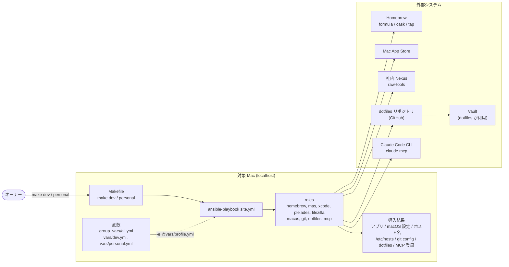
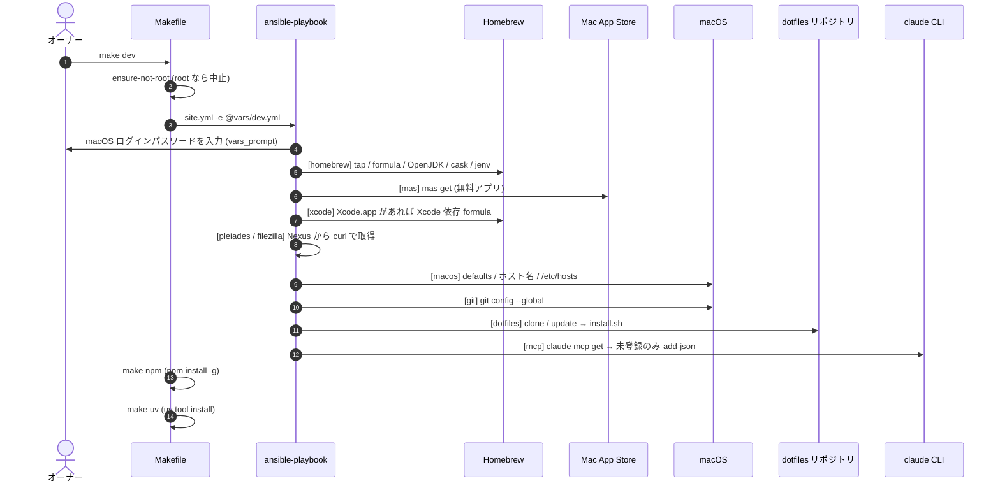
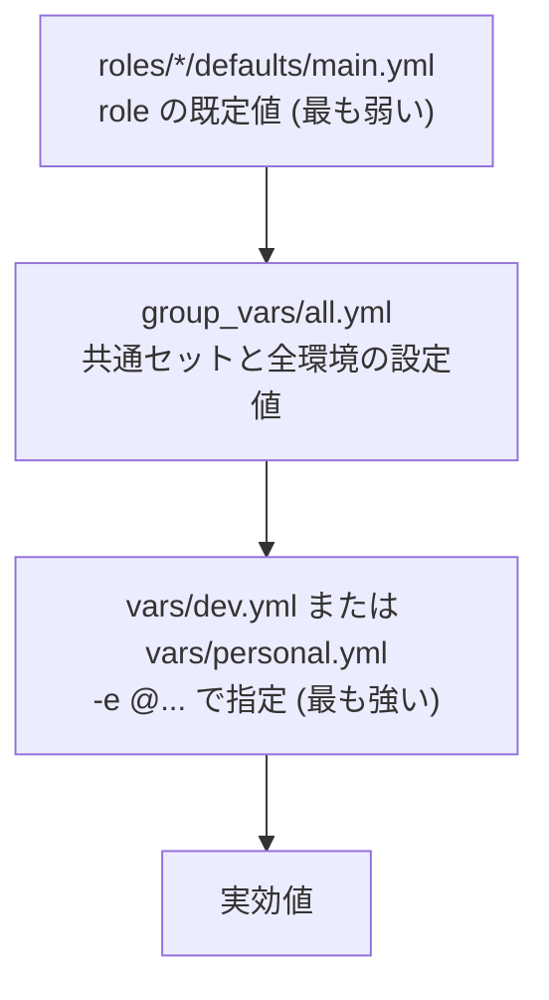
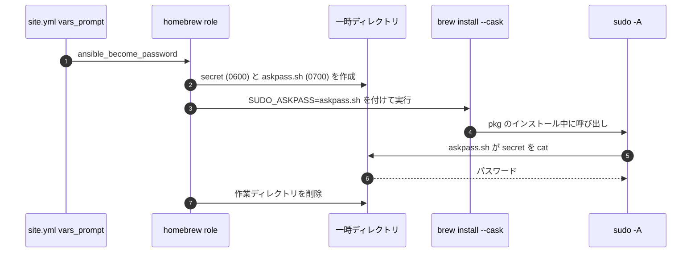
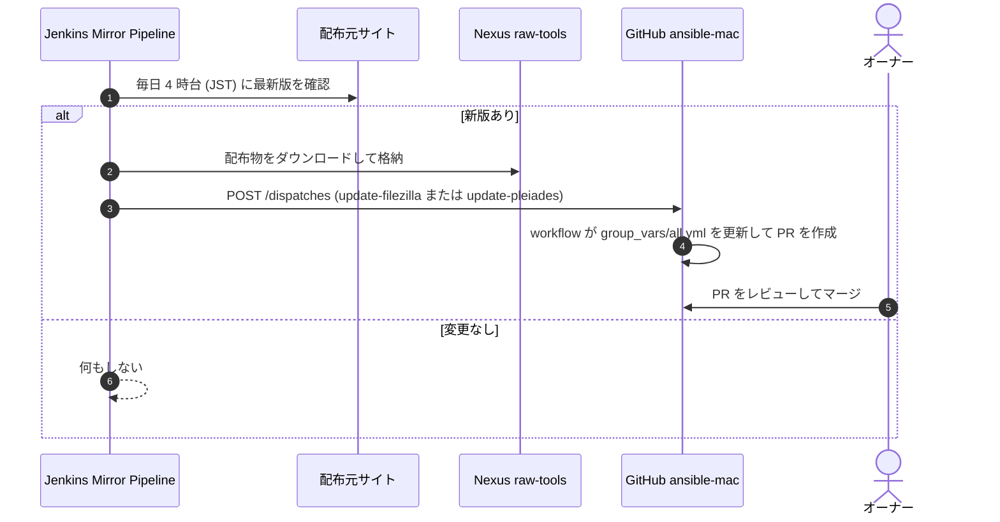

# 基本設計書

| 項目 | 内容 |
| --- | --- |
| 最終更新 | 2026-10-24（`main` @ `dae2319` ＋ Wiki ミラー追加時点） |
| 対応する要件 | [requirements.md](requirements.md)（FR-xx / NFR-xx） |
| 詳細 | [detailed-design.md](detailed-design.md)（role ごとの処理・変数・ワークフロー） |
| 設計の理由 | [design-decisions.md](design-decisions.md) |

## 1. 設計方針

| # | 方針 | 具体化 |
| --- | --- | --- |
| 1 | **宣言的かつ冪等** | Ansible で「あるべき状態」を書き、何度実行しても同じ状態に収束させる（NFR-01） |
| 2 | **共通 + 差分** | 両プロファイルに共通のものは `group_vars/all.yml` に 1 回だけ書き、プロファイルは差分だけを持つ（FR-02） |
| 3 | **値は変数、処理は role** | 導入対象や設定値は YAML の変数、手順は role に分ける。対象の追加は変数の編集だけで済ませる（NFR-05） |
| 4 | **秘密情報を持たない** | リポジトリは公開。パスワードやトークンはリポジトリ・ログ・設定ファイルに平文で残さない（NFR-02、NFR-10） |
| 5 | **止まらずに進む** | 個別の cask の失敗では全体を止めず、残りを続ける（NFR-04） |
| 6 | **自動化できない所は手順で補う** | Pleiades / FileZilla の展開、App Store へのサインインなどは [operations.md](operations.md) に手順を書く |

## 2. システム構成

### 2.1 全体構成



Ansible はコントロールノードと対象ノードが同一の Mac（`localhost`、`ansible_connection=local`）で、
SSH は使いません。

### 2.2 構成要素

| 要素 | 場所 | 役割 |
| --- | --- | --- |
| エントリーポイント | `Makefile` | プロファイルの選択、root 実行の拒否、前提ツールの導入、npm / uv ツールの導入 |
| Ansible 設定 | `ansible.cfg` | インベントリと `roles_path`、出力形式（`default` + `result_format = yaml`）、`become` の既定は無効 |
| インベントリ | `inventory/localhost` | `localhost` を `ansible_connection=local`、インタプリタ `/usr/bin/python3` で定義 |
| Playbook | `site.yml` | role の実行順序とタグ、sudo パスワードの入力（`vars_prompt`） |
| role | `roles/*` | 機能単位の処理（9 個）。既定値は `roles/*/defaults/main.yml` |
| 共通変数 | `group_vars/all.yml` | 共通セット、Git・dotfiles の設定、Pleiades / FileZilla の取得元 |
| プロファイル | `vars/dev.yml`, `vars/personal.yml` | 共通セットへの差分。`-e @vars/<profile>.yml` で読み込む |
| 依存 collection | `requirements.yml` | `community.general`（Homebrew、`osx_defaults`、`git_config` など） |
| スクリプト | `scripts/import-app-settings.sh`, `scripts/sync-wiki.sh` | 現環境のアプリ設定を dotfiles へ取り込む / `docs/` を Wiki 用に変換する |
| CI | `.github/workflows/*`, `.yamllint`, `.ansible-lint` | 静的検査、版数追従 PR の自動作成、`docs/` の Wiki ミラー |

### 2.3 ディレクトリ構成

```text
ansible-mac/
├── Makefile                  # エントリーポイント
├── ansible.cfg               # Ansible 設定
├── requirements.yml          # Ansible collection 依存
├── site.yml                  # メイン playbook
├── inventory/localhost       # ローカル実行用インベントリ
├── group_vars/all.yml        # 共通変数
├── vars/
│   ├── dev.yml               # 開発用プロファイル
│   └── personal.yml          # 普段使い用プロファイル
├── roles/
│   ├── homebrew/             # tap / formula / OpenJDK / cask / jenv
│   ├── mas/                  # Mac App Store アプリ
│   ├── xcode/                # Xcode 依存 formula
│   ├── pleiades/             # Pleiades DMG の取得
│   ├── filezilla/            # FileZilla アーカイブの取得
│   ├── macos/                # macOS 設定 / ホスト名 / /etc/hosts
│   ├── git/                  # Git グローバル設定
│   ├── dotfiles/             # dotfiles の clone/update と install
│   └── mcp/                  # Claude Code の MCP サーバ登録
├── scripts/
│   ├── import-app-settings.sh   # アプリ設定を dotfiles へ取り込む
│   └── sync-wiki.sh             # docs/ を Wiki 用に変換する
├── .github/workflows/
│   ├── ci.yml                                   # 静的検査
│   ├── ansible-mac-update-mac-app-version.yml   # 版数追従 PR の自動作成
│   └── sync-wiki.yml                            # docs/ の Wiki ミラー
├── .yamllint / .ansible-lint # lint 設定
└── docs/                     # 本ドキュメント（Wiki にも反映）
```

### 2.4 外部システム

| 外部システム | 用途 | 接続方法 |
| --- | --- | --- |
| Homebrew | formula / cask / tap の取得 | `community.general.homebrew*` モジュール、`brew` コマンド |
| Mac App Store | 無料アプリの取得 | `mas get <id>` |
| 社内 Nexus（`raw-tools`） | Pleiades / FileZilla の配布物 | `curl --fail --location` |
| dotfiles リポジトリ（GitHub） | 設定ファイルの取得と展開 | `ansible.builtin.git`、`install.sh` |
| Vault | SSH / AWS の認証情報と `~/.secrets.env` の復元 | dotfiles の `install.sh --restore-secrets` 経由（`vault` CLI） |
| Claude Code CLI | MCP サーバの登録 | `claude mcp get` / `claude mcp add-json` |
| npm / PyPI / GitHub | MCP サーバや CLI ツールの取得 | `npx -y`、`uvx --from git+...`、`npm install -g`、`uv tool install` |
| Jenkins Mirror Pipeline | Pleiades / FileZilla の新版検知と Nexus へのミラー | GitHub `repository_dispatch` を受信 |
| GitHub Actions | 静的検査、版数追従 PR の作成、Wiki ミラー | `.github/workflows/*` |
| GitHub Wiki | `docs/` の公開（一方向のミラー） | `<repo>.wiki.git` へ `git push`（8.4） |

## 3. 実行モデル

### 3.1 実行の流れ



`make personal` は、手順 13・14（`make npm` / `make uv`）を実行しません。それ以外は `-e @vars/personal.yml` で同じ流れです。

### 3.2 role の実行順序と依存

`site.yml` の `roles:` の並びがそのまま実行順序です。

| 順 | role | タグ | 主な処理 | この位置にある理由 |
| --- | --- | --- | --- | --- |
| 1 | `homebrew` | `homebrew` | tap / formula / OpenJDK / cask / jenv 登録 | 後続が使うコマンド（`mas`、`jenv`、`claude`、`vault`）をここで導入する |
| 2 | `mas` | `mas` | App Store アプリの取得 | `mas` コマンドは 1 で導入される。Xcode もここで入る |
| 3 | `xcode` | `homebrew`, `xcode` | Xcode 依存 formula の導入 | `Xcode.app`（2 で導入）が存在することが条件 |
| 4 | `pleiades` | `pleiades` | DMG の取得（`dev` のみ） | 他に依存しない |
| 5 | `filezilla` | `filezilla` | アーカイブの取得 | 他に依存しない |
| 6 | `macos` | `macos` | `defaults`、ホスト名、`/etc/hosts` | 他に依存しない（`/etc/hosts` に `sudo` が必要） |
| 7 | `git` | `git` | Git グローバル設定 | `git` formula（1）の後 |
| 8 | `dotfiles` | `dotfiles` | dotfiles の取得と展開 | `git`（取得）と `vault`（`personal` の秘密情報復元）の後 |
| 9 | `mcp` | `mcp` | MCP サーバの登録 | `claude` コマンド（1 の cask）と `~/.secrets.env`（8）の後 |

`xcode` role だけはタグを 2 つ持つため、`--tags homebrew` を指定すると `xcode` role も実行されます。

### 3.3 実行時の入力

`site.yml` の `vars_prompt` が、実行の冒頭で macOS ログインパスワードを 1 度だけ尋ねます（確認のため 2 回入力）。
取得した値は `ansible_become_password` として、次の 2 か所で使います。

- Ansible の `become`（`/etc/hosts` の書き換え）
- Homebrew cask の pkg インストールが内部で呼ぶ `sudo`（askpass 経由、後述）

`sudo` が不要な対象（`git` / `dotfiles` など）だけを実行するときは、空のまま Enter で構いません。

## 4. 変数設計

### 4.1 レイヤ構造



| 優先度 | 定義場所 | 読み込み | 役割 |
| --- | --- | --- | --- |
| 低 | `roles/*/defaults/main.yml` | role の既定値 | role 単体で動くための初期値（空リストや無効状態） |
| 中 | `group_vars/all.yml` | playbook と同じ階層から自動 | 共通セットと、プロファイルに依らない設定 |
| 高 | `vars/<profile>.yml` | `-e @vars/<profile>.yml` | プロファイル固有の差分と、用途名などの上書き |

プロファイルを extra vars（`-e`）で渡すため、`group_vars/all.yml` の値はいつでもプロファイル側で上書きできます。
Git（`init.defaultBranch` / `core.editor`）や dotfiles のように、role の既定値と `group_vars/all.yml` に同じ値を重ねて書いている変数もあります。

### 4.2 「共通 + 差分」の合成

リスト型の変数は、共通のリストにプロファイル固有のリストを足して合成します。

```yaml
# group_vars/all.yml
homebrew_packages_common: [ ... ]        # 共通
homebrew_packages: "{{ homebrew_packages_common }}"   # プロファイル未指定のときの既定

# vars/dev.yml
homebrew_packages: "{{ homebrew_packages_common + homebrew_packages_dev_extra }}"
homebrew_packages_dev_extra: [ ... ]     # dev だけの差分
```

同じ形式を `homebrew_casks`（`*_common` / `*_dev_extra` / `*_personal_extra`）と
`mas_apps`（同上）にも使っています。`group_vars/all.yml` のコメントにあるとおり、
プロファイルを指定しない実行（部分実行の `make homebrew` など）では共通セットだけが見えます。

### 4.3 命名規則

| 規則 | 例 |
| --- | --- |
| role 名を接頭辞にする | `homebrew_*`, `macos_*`, `git_*`, `dotfiles_*`, `mcp_*` |
| 共通セットは `*_common` | `homebrew_packages_common`, `mas_apps_common` |
| プロファイル差分は `*_<profile>_extra` | `homebrew_casks_dev_extra`, `mas_apps_personal_extra` |
| 機能の有効 / 無効は `*_enabled` | `pleiades_enabled`, `filezilla_enabled`, `mcp_enabled` |
| 自動更新される値は単独の変数にする | `filezilla_version`, `pleiades_release`, `pleiades_version` |

### 4.4 プロファイルの比較

2 つのプロファイルの違いは「開発に必要なものを入れるか」です。両者に共通する互換 CLI、エディタ、Office、AI ツールなどは、
この環境そのものを反映するために共通セットへ置いています。

| 項目 | `dev` | `personal` |
| --- | --- | --- |
| 共通 CLI（bat / eza / ripgrep / vim / ffmpeg など） | ✅ | ✅ |
| ansible / git / vault / mas | ✅ | ✅ |
| Node.js / nodenv / OpenJDK / jenv / uv | ✅ | ✅ |
| VS Code / wezterm / Chrome / qview / VLC | ✅ | ✅ |
| Microsoft Office / OneDrive | ✅ | ✅ |
| Discord / Slack | ✅ | ✅ |
| AI アシスタント（Claude / ChatGPT / Codex / Copilot の GUI・CLI） | ✅ | ✅ |
| フォント | ✅ | ✅ |
| LanguageTranslator / Tailscale / Windows App / WireGuard | ✅ | ✅ |
| FileZilla の取得 | ✅ | ✅ |
| dotfiles の展開 | ✅ | ✅（`--restore-secrets` 付き） |
| MCP サーバの登録 | ✅ | ✅ |
| 開発系 CLI（gh / helm / maven / go など 17 種） | ✅ | ❌ |
| Docker / Postman / Sourcetree | ✅ | ❌ |
| swiftlint / Pleiades の取得 | ✅ | ❌ |
| Xcode / TestFlight / Developer / PL2303Serial | ✅ | ❌ |
| npm / uv のグローバルツール | ✅ | ❌ |
| Thunderbird / Webex | ❌ | ✅ |
| Kindle / LINE | ❌ | ✅ |
| ホスト名の用途名 | `DEV` | `OA` |

個々のパッケージは [catalog.md](catalog.md) を参照してください。

## 5. 権限・セキュリティ設計

### 5.1 権限モデル

| 操作 | 必要な権限 | 方法 |
| --- | --- | --- |
| Ansible の実行全般 | 一般ユーザー | `ansible.cfg` で `become = False`。Makefile の `ensure-not-root` が root 実行を拒否する |
| Homebrew の操作 | 一般ユーザー | Homebrew は root で動かさない（`sudo make ...` は不可） |
| pkg 系 cask が内部で呼ぶ `sudo` | 管理者パスワード | askpass ヘルパ（5.2） |
| `/etc/hosts` の書き換え | root | `become: true` と `ansible_become_password` |
| ホスト名の設定（`scutil --set`） | — | `become` を指定していない。管理者権限が必要な場合の挙動は実機で確認する（[testing.md](testing.md) の TC-09） |

`ensure-not-root` は `dev` / `personal` / `homebrew` / `mas` / `macos` の各ターゲットが呼びます。

### 5.2 sudo パスワードの受け渡し（askpass）

pkg ベースの cask（Microsoft Office、`docker-desktop`、`webex-meetings` など）は、インストール中に内部で `sudo` を呼びます。
Ansible は非対話で動くため、パスワードを渡す仕組みがないと次のエラーで失敗します。

```text
sudo: a terminal is required to read the password
sudo: a password is required
```

`SUDO_ASKPASS` が設定されていると、Homebrew は `sudo -A` で呼び出し、askpass ヘルパからパスワードを読みます。
この仕組みを次のように用意します。



設計上のポイントは次のとおりです。

- パスワードは askpass スクリプトに埋め込まず、別ファイル（`secret`）に置いて `cat` させる。`$` や `\` などの特殊文字で壊れないため
- パスワード入力は `private`・`unsafe`・`confirm`。Ansible のテンプレート展開を受けず、画面にも出ない
- 関連タスクは `no_log: true`
- パスワードが空のときは、この仕組み全体を使わない
- 以前の `--ask-become-pass` は `ansible_become_password` 変数を設定しないため askpass が常に無効だった。このため `vars_prompt` に切り替えた（[design-decisions.md](design-decisions.md) の ADR-03）

### 5.3 機密情報の扱い

| 情報 | 保管場所 | 扱い |
| --- | --- | --- |
| macOS ログインパスワード | 実行中の変数のみ | 5.2 のとおり。一時ファイルは cask 導入後に削除する |
| MCP サーバの API トークン類 | `~/.secrets.env`（リポジトリ外。Vault から復元） | MCP の起動コマンドが実行時に読み込む。登録時に `expand_argument_vars: false` とし、`$HOME` や `$VAR` を展開させないため、`~/.claude.json` に値が焼き込まれない |
| SSH / AWS の認証情報 | Vault | dotfiles の `install.sh --restore-secrets` で復元する |
| 更新ワークフローのトークン | GitHub Actions Secrets（`RELEASE_PAT`） | リポジトリには書かない |
| Jenkins から dispatch を送るトークン | Jenkins の Credentials | リポジトリには書かない |
| アプリ設定の取り込み | `scripts/import-app-settings.sh` の除外 | パスワード DB・証明書 DB・メール本体・VS Code の `globalStorage` などは取り込まない |

### 5.4 公開リポジトリとしての扱い

このリポジトリは公開です。次の情報は公開されている前提で運用します（秘密ではない情報だけを置く）。

- Git の氏名・メールアドレス（`group_vars/all.yml`）
- 社内の FQDN、内部 VIP、Nexus の URL
- Jenkins から GitHub Actions へ版数を伝える仕組み

トークンやパスワードをコミットしないこと、秘密情報は Vault と GitHub Secrets に置くことが運用ルールです。

## 6. エラーハンドリングと冪等性

### 6.1 エラー処理の方針

| 場面 | 方針 | 実装 |
| --- | --- | --- |
| 個別の cask の導入失敗 | 失敗を無視して続行。再実行か手動導入で対処 | `Install Homebrew casks` の `ignore_errors: true` |
| `mas get` が `sudo: a password is required` で失敗 | 失敗扱いにしない | `failed_when` で当該メッセージを除外 |
| `jenv add` が登録済みで失敗 | 失敗扱いにしない | `failed_when` で `already` を除外 |
| Finder / Dock の再起動失敗 | 無視 | `ignore_errors: true` |
| `claude` コマンドが無い | 警告を出して MCP 登録をスキップ | `which claude` の結果で `when` を制御 |
| 取得 URL が 404 などで失敗 | 失敗として停止 | `curl --fail` |
| 取得済みファイルがある | 再取得しない | `args.creates` |
| `scutil --get` の失敗 | 無視（現在値が空として扱い、設定する） | `failed_when: false` |
| dotfiles の `install.sh` が失敗 | 失敗として停止 | `ansible.builtin.command` の戻り値。なお `--restore-secrets` の Vault 復元失敗は `install.sh` 側で継続扱いになる |

### 6.2 冪等性

| role | 状況 | 補足 |
| --- | --- | --- |
| `homebrew` | ○ | `update_homebrew: true` のため `brew update` が毎回走る。`jenv add` は新規登録時だけ changed |
| `mas` | △ | 成功した `mas get` は常に changed と表示される（[known-issues.md](known-issues.md) の KI-06） |
| `xcode` | ○ | |
| `pleiades` / `filezilla` | ○ | 取得済みなら何もしない |
| `macos` | ○ | `defaults` とホスト名は差分があるときだけ変更。`/etc/hosts` は管理ブロックを置換。Finder / Dock の再起動は毎回行うが changed とは数えない |
| `git` | ○ | |
| `dotfiles` | ○ | `git` の更新と、リンク作成 / バックアップがあるときだけ changed |
| `mcp` | ○ | 未登録のサーバだけを追加する。登録済みの定義は更新しない |

## 7. 外部インタフェース

| 相手 | 方向 | 内容 | 契約・前提 |
| --- | --- | --- | --- |
| Nexus | 取得 | `https://nexus.sk4869.info/repository/raw-tools/eclipse/<release>/<filename>`<br/>`https://nexus.sk4869.info/repository/raw-tools/filezilla/<version>/<filename>` | Mirror Pipeline が配置するパスと、`group_vars/all.yml` の URL 組み立てが一致していること |
| dotfiles リポジトリ | 取得・実行 | `install.sh` を実行（`personal` は `--restore-secrets` 付き） | 標準出力に `リンク作成:` または `バックアップ:` を出すこと。`dotfiles` role はこの文字列で changed を判定する |
| Vault | 間接 | dotfiles が `~/.secrets.env` などを復元する | `vault` CLI と Vault へのログインが済んでいること |
| Claude Code CLI | 実行 | `claude mcp get <name>` の終了コードで登録有無を判定し、`claude mcp add-json` で登録 | `claude` が PATH にあること |
| Mirror Pipeline → GitHub | 受信 | `repository_dispatch`（`update-filezilla` / `update-pleiades`） | 8.2 を参照 |

`brew`、`mas`、`jenv`、`claude` などは、Ansible の `command` が PATH から見つけます。
新規 Mac では、`make init` の後に Homebrew の PATH（`eval "$(/opt/homebrew/bin/brew shellenv)"`）を通したシェルから実行してください。
dotfiles の `.zprofile` は、展開後の新しいシェルで同じ設定を行います。

## 8. CI/CD 設計

### 8.1 CI（`ci.yml`）

`pull_request` と `main` への `push` で、`ubuntu-latest` 上の 1 ジョブ（`Format, Indent, Static Check`）が次を順に実行します。

| 順 | チェック | コマンド | 設定 |
| --- | --- | --- | --- |
| 1 | YAML の書式・インデント | `yamllint .` | `.yamllint`（`extends: default`、行長 120 は warning） |
| 2 | シェルの書式 | `shfmt -d -i 2 -ci` を追跡中の `*.sh` に対して実行 | インデント 2、`case` のインデントあり |
| 3 | Ansible の静的検査 | `ansible-lint` | `.ansible-lint`（`profile: basic`、`ignore-errors` と `risky-shell-pipe` を除外） |
| 4 | Playbook の構文 | `ansible-playbook site.yml --syntax-check` | `requirements.yml` の collection を導入して実行 |

macOS のランナーは使わないため、実機での適用（`defaults`、Homebrew、MAS）は CI では検証されません
（[testing.md](testing.md) を参照）。

### 8.2 版数の自動追従

Pleiades と FileZilla は Homebrew cask にないため、社内 Nexus に置いた配布物を取得します。
新版の検知と Nexus への配置は Jenkins の Mirror Pipeline（別リポジトリ `jenkins-cli`）が担い、
このリポジトリは通知を受けて `group_vars/all.yml` の版数を更新する PR を作ります。



| 項目 | 内容 |
| --- | --- |
| 受信イベント | `repository_dispatch` の `update-filezilla` / `update-pleiades` |
| ペイロード | `update-filezilla`: `version`（例 `3.70.5`）<br/>`update-pleiades`: `release`（例 `2026-03`）と `buildDate`（例 `20260322`） |
| 更新対象 | `group_vars/all.yml` の `filezilla_version` / `pleiades_release` / `pleiades_version` |
| 作成するもの | ブランチ `auto/filezilla-<version>` または `auto/pleiades-<release>-<buildDate>`、タイトル `chore: ...` の PR（ラベル `automated`, `mac-app-update`） |
| 差分なしのとき | PR を作らない |
| 必要な Secrets | `RELEASE_PAT`（`repo` スコープの PAT）。`GITHUB_TOKEN` で作った PR では追従する CI が起動しないため |
| 並行実行 | イベント種別ごとに `concurrency` を分け、実行中のジョブは取り消さない |
| マージ | 自動では行わない。オーナーがレビューしてマージする |

Jenkins 側が dispatch に失敗してもミラー自体は成功として扱われます。逆にこのリポジトリ側で失敗しても、
Jenkins には伝わりません。`RELEASE_PAT` が未登録のため現在は失敗する状態です（[known-issues.md](known-issues.md) の KI-01）。

### 8.3 品質ゲートの現状

`main` にブランチ保護と ruleset はなく、CI は必須チェックになっていません（2026-10-24 時点）。
ansible-lint は既知の 3 件の違反で失敗し続けています（[known-issues.md](known-issues.md) の KI-05）。

### 8.4 Wiki ミラー

`docs/` を GitHub Wiki へ一方向に反映します（ワークフロー `sync-wiki.yml`、変換は `scripts/sync-wiki.sh`）。
正本は `docs/` で、Wiki 上の編集は次の同期で上書きされます。Wiki は別リポジトリで、PR レビューや CI の対象外のため、
レビューは `docs/` への PR で行い、Wiki は読むための入口として使います。

| 項目 | 内容 |
| --- | --- |
| トリガー | `docs/**`、`scripts/sync-wiki.sh`、ワークフロー自身の変更を `main` へ push したとき。手動実行（`workflow_dispatch`）も可 |
| PR での検査 | 同じ変更を含む PR では `validate` ジョブが、変換とリンクの検査だけを行う（Wiki には書かない） |
| ページの対応 | `docs/README.md` は `Home`、`docs/<name>.md` は `<name>`。`_Sidebar.md`（日本語の見出し付き）と `_Footer.md` を生成する |
| リンクの変換 | `<name>.md` は `<name>`、`<name>.md#見出し` は `<name>#見出し`、`../README.md` はリポジトリ上の URL にする。コードブロックの中は変換しない |
| 失敗させる条件 | 存在しないページ、またはファイルパスのリンクが残るとき。Wiki には何も書かずに終了する |
| 管理対象の判別 | 生成したページの先頭に、マーカーの HTML コメントを入れる。`docs/` から消えたページは、マーカーがあるものだけ削除する。手で作ったページには触らない |
| 認証 | `GITHUB_TOKEN`（`contents: write`）。権限エラーになる場合は、Secrets の `WIKI_TOKEN`（`repo` スコープの PAT）があればそれを優先して使う |
| 前提 | Wiki の最初のページが作成済みであること。未作成だと `<repo>.wiki.git` が存在せず、clone に失敗する |
| 同時実行 | `concurrency` で直列化し、実行中のジョブは取り消さない |
| 差分がないとき | commit も push もしない |

ページ名は、`requirements` のような ASCII の文書名です。日本語の名称は、サイドバーの見出しで補います。
設計の理由は [design-decisions.md](design-decisions.md) の ADR-15 を参照してください。

## 9. 運用設計の要点

- 反映は「YAML を編集 → `make check-*` ではなく実機で再実行」が基本です。ドライランには制約があります（KI-02）。
- 版数の更新は、自動（Jenkins → PR）と手動（`group_vars/all.yml` を編集）の 2 通りです。
- `docs/` の変更は、`main` にマージされると Wiki へ自動で反映されます（8.4）。
- 変更は作業ブランチから PR を作り、squash マージします（コミットメッセージは `<type>: <日本語の説明>`）。
- 手順とトラブルシューティングは [operations.md](operations.md) にまとめています。

## 10. 設計上の制約と既知の課題

設計に由来する制約と、確認済みの不具合は [known-issues.md](known-issues.md) にまとめています。
特に、部分実行ターゲットがプロファイルを引き継がない点（KI-03）と、Dock の設定で `macos` role が止まりうる点（KI-14）は、
運用に影響するため一読してください。
