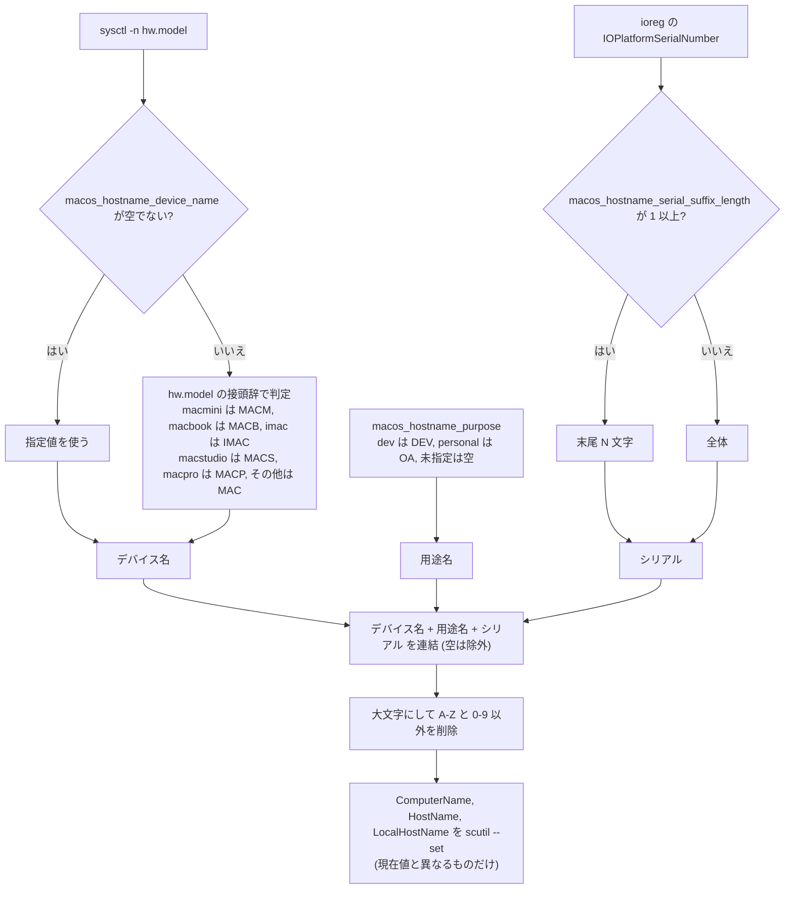

# 詳細設計書

| 項目 | 内容 |
| --- | --- |
| 最終更新 | 2026-10-24（`main` @ `666591a` 時点） |
| 上位文書 | [basic-design.md](basic-design.md)（構成・実行モデル・セキュリティ） |
| 対象 | `Makefile`、Ansible 設定、変数、各 role、スクリプト、GitHub Actions |

> 値は作成時点のものです。正は各 YAML です。版数（FileZilla / Pleiades）は自動更新されるため、ここには書きません。

## 1. Makefile

### 1.1 変数

| 変数 | 値 | 用途 |
| --- | --- | --- |
| `PLAYBOOK` | `ansible-playbook site.yml` | 全ターゲットが使う実行コマンド |
| `NPM_PACKAGES` | `@github/copilot @redocly/cli mcp-proxy multi-file-swagger pnpm yarn` | `make npm` の対象 |
| `UV_TOOLS` | `serena-agent` | `make uv` の対象 |

### 1.2 ターゲット

| ターゲット | 実行内容 | プロファイル | root ガード |
| --- | --- | --- | --- |
| `help`（`all`） | 使い方の表示 | — | — |
| `init` | 前提ツールの導入（1.4） | — | なし |
| `dev` | `ansible-playbook site.yml -e @vars/dev.yml` → `make npm` → `make uv` | `dev` | あり |
| `personal` | `ansible-playbook site.yml -e @vars/personal.yml` | `personal` | あり |
| `check-dev` | `ansible-playbook site.yml -e @vars/dev.yml --check` | `dev` | なし |
| `check-personal` | `ansible-playbook site.yml -e @vars/personal.yml --check` | `personal` | なし |
| `homebrew` | `--tags homebrew` | **なし** | あり |
| `mas` | `--tags mas` | **なし** | あり |
| `pleiades` | `--tags pleiades` | **なし** | なし |
| `filezilla` | `--tags filezilla` | **なし** | なし |
| `macos` | `--tags macos` | **なし** | あり |
| `git` | `--tags git` | **なし** | なし |
| `dotfiles` | `--tags dotfiles` | **なし** | なし |
| `import-settings` | `scripts/import-app-settings.sh` | — | なし |
| `npm` | `NPM_PACKAGES` を `npm list -g` で確認し、未導入のものだけ `npm install -g` | — | なし |
| `uv` | `UV_TOOLS` を `uv tool list` で確認し、未導入のものだけ `uv tool install` | — | なし |
| `ensure-not-root` | `id -u` が 0 なら中止（内部用） | — | — |

`.PHONY` と `help` には `xcode` も載っていますが、`xcode:` のレシピは `Makefile` にありません。
`make xcode` は何も実行せずに成功します。`mcp` のターゲットは存在しません（[known-issues.md](known-issues.md) の KI-04）。

### 1.3 プロファイルと部分実行

部分実行ターゲットは `-e @vars/<profile>.yml` を渡しません。このため `group_vars/all.yml` と role の既定値だけが見え、
プロファイルの上書きは効きません。

| ターゲット | 実際に起きること |
| --- | --- |
| `make homebrew` | 共通の formula 21 / cask 24 だけを導入する。`dev` 追加分は入らない。`xcode` role も走るが `xcode_homebrew_packages` は空 |
| `make mas` | 共通の 4 アプリだけを取得する |
| `make pleiades` | `pleiades_enabled` が `false` のため何もしない |
| `make filezilla` | 共通で有効なので取得する |
| `make macos` | `macos_hostname_purpose` が空になり、ホスト名が `<デバイス名><シリアル>` に変わる（`DEV` / `OA` が消える） |
| `make git` | 影響なし（`group_vars/all.yml` の値だけを使う） |
| `make dotfiles` | `personal` でも `--restore-secrets` を付けない |

プロファイルを保ったまま部分実行するには、直接 `ansible-playbook` を使います。

```bash
ansible-playbook site.yml --tags macos -e @vars/dev.yml
ansible-playbook site.yml --tags mcp           # make ターゲットがないため
```

### 1.4 `make init` の処理

1. `uname -s` が `Darwin` でなければ中止する
2. `brew` が無ければ、Homebrew の公式インストーラ（`install.sh`）を取得して実行する
3. `brew`（`command -v`、無ければ `/opt/homebrew/bin/brew`、さらに `/usr/local/bin/brew`）を探し、見つからなければ中止する
4. `ansible` が未導入なら `brew install ansible`
5. `ansible-galaxy collection install -r requirements.yml`（`ansible-galaxy` は PATH、無ければ `$(brew --prefix)/bin` から探す）

## 2. Ansible 設定・インベントリ・playbook

### 2.1 `ansible.cfg`

| 設定 | 値 | 意図 |
| --- | --- | --- |
| `inventory` | `inventory/localhost` | 引数なしで `localhost` に実行する |
| `roles_path` | `roles` | リポジトリ内の role を使う |
| `host_key_checking` | `False` | SSH のホスト鍵確認を無効にする。本リポジトリは `local` 接続なので実質的な効果はない |
| `retry_files_enabled` | `False` | `.retry` ファイルを作らない |
| `stdout_callback` / `result_format` | `default` / `yaml` | 結果を YAML 形式で出力する。`yaml` コールバックから移行した（コミット `4afb00b`） |
| `[privilege_escalation] become` | `False` | 昇格は必要なタスクだけが明示する |

### 2.2 インベントリ

`inventory/localhost` に `[local]` グループ 1 つと `localhost ansible_connection=local ansible_python_interpreter=/usr/bin/python3` のみです。

### 2.3 `site.yml`

| 項目 | 値 |
| --- | --- |
| `hosts` / `connection` | `local` / `local` |
| `gather_facts` | `true`（`ansible_architecture`、`ansible_env.HOME` などを使う） |
| `vars_prompt` | `ansible_become_password`（`private: true`、`unsafe: true`、`confirm: true`） |
| `roles` | `homebrew` → `mas` → `xcode` → `pleiades` → `filezilla` → `macos` → `git` → `dotfiles` → `mcp` |

タグは role 名と同じです。`xcode` role だけは `homebrew` と `xcode` の 2 つを持ちます。

`ansible_become_password` を `-e` で渡すと `vars_prompt` は表示されません（自動化やテストで使えます）。

### 2.4 `requirements.yml`

`community.general` のみです。`homebrew`、`homebrew_tap`、`homebrew_cask`、`osx_defaults`、`git_config` を使います。

## 3. 変数一覧

### 3.1 共通（`group_vars/all.yml`）

| 変数 | 値 | 使う role | 説明 |
| --- | --- | --- | --- |
| `homebrew_taps` | `[hashicorp/tap]` | homebrew | 共通の tap |
| `homebrew_packages_common` | 21 formula | （合成用） | 共通 formula |
| `homebrew_packages` | `homebrew_packages_common` | homebrew | プロファイル未指定のときの既定 |
| `homebrew_casks_common` | 24 cask | （合成用） | 共通 cask |
| `homebrew_casks` | `homebrew_casks_common` | homebrew | 同上 |
| `mas_apps_common` | 4 アプリ | （合成用） | 共通の App Store アプリ |
| `mas_apps` | `mas_apps_common` | mas | 同上 |
| `git_user_name` / `git_user_email` | 値は YAML を参照 | git | `user.name` / `user.email` |
| `git_default_branch` | `main` | git | `init.defaultBranch` |
| `git_core_editor` | `vim` | git | `core.editor` |
| `dotfiles_repo` | `https://github.com/YukiOno-1015/dotfiles.git` | dotfiles | dotfiles リポジトリ |
| `dotfiles_dest` | `~/dotfiles` | dotfiles | clone 先 |
| `dotfiles_version` | `main` | dotfiles | ブランチ / タグ / コミット |
| `dotfiles_update` | `true` | dotfiles | 既存 clone を更新する |
| `dotfiles_install_command` | `./install.sh` | dotfiles | clone 後に実行するコマンド（空なら実行しない） |
| `homebrew_java_packages` | `openjdk`, `openjdk@8`, `@11`, `@17`, `@21` | homebrew | jenv に登録する OpenJDK |
| `xcode_homebrew_packages` | `[]` | xcode | `dev` で上書き |
| `pleiades_enabled` | `false` | pleiades | `dev` で `true` |
| `pleiades_release` / `pleiades_version` | 自動更新 | pleiades | リリース表記（例 `2026-03`）と build date（例 `20260322`） |
| `pleiades_filename` | `pleiades-<release>-java-mac-jre_<version>.dmg` | pleiades | ファイル名 |
| `pleiades_url` | Nexus `raw-tools/eclipse/<release>/<filename>` | pleiades | 取得元 |
| `pleiades_download_dest` | `~/Downloads/<filename>` | pleiades | 保存先 |
| `filezilla_enabled` | `true` | filezilla | 取得するか |
| `filezilla_version` | 自動更新 | filezilla | クライアントの版数 |
| `filezilla_filename` | `FileZilla_<version>_macos-arm64.app.tar.bz2` | filezilla | ファイル名（Apple Silicon 用） |
| `filezilla_url` | Nexus `raw-tools/filezilla/<version>/<filename>` | filezilla | 取得元 |
| `filezilla_download_dest` | `~/Downloads/<filename>` | filezilla | 保存先 |

### 3.2 プロファイル

| 変数 | `vars/dev.yml` | `vars/personal.yml` |
| --- | --- | --- |
| `macos_hostname_purpose` | `DEV` | `OA` |
| `homebrew_taps` | `[hashicorp/tap]`（共通と同じ） | 未定義（共通を使う） |
| `homebrew_packages` | `homebrew_packages_common + homebrew_packages_dev_extra` | 未定義（共通を使う） |
| `homebrew_packages_dev_extra` | 17 formula | — |
| `xcode_homebrew_packages` | `[swiftlint]` | 未定義（共通の `[]`） |
| `pleiades_enabled` | `true` | 未定義（共通の `false`） |
| `homebrew_casks` | `homebrew_casks_common + homebrew_casks_dev_extra` | `homebrew_casks_common + homebrew_casks_personal_extra` |
| `homebrew_casks_*_extra` | dev: 4 cask | personal: 3 cask |
| `mas_apps` | `mas_apps_common + mas_apps_dev_extra` | `mas_apps_common + mas_apps_personal_extra` |
| `mas_apps_*_extra` | dev: 4 アプリ | personal: 2 アプリ |
| `dotfiles_install_command` | 未定義（共通の `./install.sh`） | `./install.sh --restore-secrets` |

### 3.3 role の既定値

| role | 変数 | 既定値 | 備考 |
| --- | --- | --- | --- |
| homebrew | `homebrew_packages` / `homebrew_casks` / `homebrew_taps` / `homebrew_java_packages` | `[]` | |
| homebrew | `homebrew_upgrade_all` | `false` | **どのタスクも参照していない**（KI-11） |
| mas | `mas_apps` | `[]` | |
| xcode | `xcode_homebrew_packages` | `[]` | |
| pleiades | `pleiades_enabled` / `pleiades_url` / `pleiades_download_dest` | `false` / `""` / `~/Downloads/pleiades-all-in-one.dmg` | 共通で上書きされる |
| filezilla | `filezilla_enabled` / `filezilla_url` / `filezilla_download_dest` | `false` / `""` / `~/Downloads/filezilla-macos.tar.bz2` | 共通で上書きされる |
| macos | 4.6 を参照 | | |
| git | `git_user_name` / `git_user_email` / `git_default_branch` / `git_core_editor` | `""` / `""` / `main` / `vim` | 共通で上書きされる |
| dotfiles | `dotfiles_repo` / `dotfiles_dest` / `dotfiles_version` / `dotfiles_update` / `dotfiles_install_command` | 共通と同じ値 | |
| mcp | `mcp_enabled` / `mcp_scope` / `mcp_servers` | `true` / `user` / 11 サーバ | |

## 4. role 詳細

### 4.1 `homebrew`

**目的**: Homebrew の tap・formula・OpenJDK・cask を導入し、OpenJDK を jenv に登録する。

| 順 | タスク | モジュール | 条件・要点 |
| --- | --- | --- | --- |
| 1 | Check Homebrew is installed | `stat` | `/opt/homebrew/bin/brew` の有無 |
| 2 | Install Homebrew | `shell` | 1 で無いときだけ。公式インストーラを実行。`changed_when: true` |
| 3 | Add Homebrew taps | `homebrew_tap` | `homebrew_taps` をループ |
| 4 | Install Homebrew packages | `homebrew` | `homebrew_packages` を一括で `present`。`update_homebrew: true` |
| 5 | Build OpenJDK package list for this Mac | `set_fact` | `ansible_architecture` が `x86_64` 以外なら `openjdk@8` を除外 |
| 6 | Install OpenJDK packages | `homebrew` | 5 の結果が空でないとき。`update_homebrew: true` |
| 7 | Create askpass work directory for pkg-based casks | `tempfile` | `ansible_become_password` が空でないとき。ディレクトリ、接尾辞 `askpass` |
| 8 | Write sudo password file and askpass helper | `copy` | 同上。`secret`（0600）と `askpass.sh`（0700）を作成。`no_log: true` |
| 9 | Install Homebrew casks | `homebrew_cask` | `homebrew_casks` を 1 件ずつ。パスワードがあれば `SUDO_ASKPASS` を設定。`ignore_errors: true` |
| 10 | Remove askpass work directory | `file` | パスワードがあるとき。ディレクトリを削除 |
| 11 | Get Homebrew prefix | `command` | `brew --prefix` |
| 12 | Add OpenJDK versions to jenv | `command` | 5 の各 formula に `jenv add <prefix>/opt/<formula>/libexec/openjdk.jdk/Contents/Home` |

- `askpass.sh` の中身は `cat '<作業ディレクトリ>/secret'` だけです。パスワードを埋め込まないので特殊文字で壊れません
- 12 は、出力に `added` を含むときだけ changed。終了コードが 0 以外でも、出力に `already` を含めば失敗にしません
- cask を 1 件ずつ導入するため、1 つの失敗が他に波及しません（失敗は無視されるので、出力で確認します）
- 手順 4・6 と、[xcode](#43-xcode) role の導入タスクは `update_homebrew: true` のため、それぞれ `brew update` を実行します

### 4.2 `mas`

**目的**: Mac App Store の無料アプリを取得する。

| タスク | モジュール | 要点 |
| --- | --- | --- |
| Install free App Store apps | `command` | `mas get <id>` を `mas_apps` の各要素に対して実行 |

- `--check` では実行しません（`when: not ansible_check_mode`）
- `changed_when: rc == 0` のため、成功すると常に changed になります
- `rc != 0` かつ標準エラーに `sudo: a password is required` が**含まれない**ときだけ失敗です。含まれる場合は失敗扱いにならず、取得されないまま進みます（KI-06）
- ループのラベルは `<name> (<id>)`

### 4.3 `xcode`

**目的**: Xcode が必要な formula を、Xcode の導入後に入れる。

| 順 | タスク | モジュール | 条件・要点 |
| --- | --- | --- | --- |
| 1 | Check Xcode app is installed | `stat` | `/Applications/Xcode.app` |
| 2 | Install Xcode dependent Homebrew packages | `homebrew` | 1 が存在し、`xcode_homebrew_packages` が空でないとき。`update_homebrew: true` |

`dev` では `swiftlint` が対象です。Xcode が未導入のときは何もせず、導入後に再実行すれば入ります。

### 4.4 `pleiades`

**目的**: Pleiades All in One の DMG を取得する（インストールは手作業）。

| 順 | タスク | モジュール | 条件 |
| --- | --- | --- | --- |
| 1 | Create Pleiades download directory | `file` | `pleiades_enabled` |
| 2 | Download Pleiades All in One DMG | `command`（`curl --fail --location --output <dest> <url>`） | `pleiades_enabled` かつ `pleiades_url` が空でない。`creates: <dest>` で取得済みならスキップ |

`# noqa: command-instead-of-module` を付けています（`get_url` でなく `curl` を使うため）。

### 4.5 `filezilla`

`pleiades` role と同じ構成です（変数は `filezilla_*`）。取得するのは Apple Silicon 用の
`.app.tar.bz2` です。Intel Mac では `filezilla_filename` / `filezilla_url` の差し替えが必要です。

### 4.6 `macos`

**目的**: macOS のシステム設定、ホスト名、内部 DNS（`/etc/hosts`）を管理する。

| 順 | タスク | 要点 |
| --- | --- | --- |
| 1 〜 7 | `osx_defaults` | Finder の隠しファイル / 拡張子、自動修正、キーリピート速度 / 遅延、Dock の自動非表示 / アイコンサイズ |
| 8 〜 9 | `file` / `osx_defaults` | スクリーンショットの保存先を作成して設定 |
| 10 〜 11 | `command` / `shell` | `sysctl -n hw.model` と、`ioreg` から取った `IOPlatformSerialNumber`（`macos_hostname_manage` のとき） |
| 12 〜 13 | `set_fact` | デバイス名の判定とホスト名の生成（下記） |
| 14 〜 15 | `command` | `scutil --get` で現在値を取得し、異なるものだけ `scutil --set` |
| 16 | `blockinfile` | `/etc/hosts` の管理ブロック（`become: true`、`macos_internal_dns_entries` が空でないとき） |
| 17 〜 18 | `command` | `killall Finder` / `killall Dock`（`ignore_errors`、`changed_when: false`） |

設定値の詳細は [catalog.md](catalog.md) の「管理対象の設定」を参照してください。

**ホスト名の生成**



**`/etc/hosts` のブロック**

`blockinfile` が次の形式のブロックを作成・更新します（`create: false` なので `/etc/hosts` が無ければ作りません）。

```text
# BEGIN ANSIBLE MANAGED: internal sk4869.info
<macos_internal_dns_vip>  <macos_internal_dns_entries の各 FQDN>
# END ANSIBLE MANAGED: internal sk4869.info
```

**変数**

| 変数 | 既定値 | 説明 |
| --- | --- | --- |
| `macos_show_hidden_files` | `true` | 隠しファイルを表示する |
| `macos_show_all_filename_extensions` | `true` | 拡張子を常に表示する |
| `macos_disable_auto_correct` | `true` | 自動修正を無効にする |
| `macos_key_repeat_rate` | `2` | キーリピート速度 |
| `macos_key_repeat_delay` | `15` | キーリピート開始までの遅延 |
| `macos_dock_autohide` | `true` | Dock を自動的に隠す |
| `macos_dock_icon_size` | `48` | Dock のアイコンサイズ。`osx_defaults` を `type: int` で使っているため、既存値が float だと失敗する（KI-14） |
| `macos_screenshots_dir` | `~/Desktop/screenshots` | スクリーンショットの保存先 |
| `macos_hostname_manage` | `true` | ホスト名を管理するか |
| `macos_hostname_device_name` | `""` | デバイス名の上書き（空なら `hw.model` から判定） |
| `macos_hostname_purpose` | `""` | 用途名（`dev` は `DEV`、`personal` は `OA`） |
| `macos_hostname_serial_suffix_length` | `0` | シリアルの末尾 N 文字を使う（`0` なら全体） |
| `macos_internal_dns_vip` | `roles/macos/defaults/main.yml` を参照 | 内部 DNS の VIP |
| `macos_internal_dns_entries` | `nexus-cli.sk4869.info`, `nexus-docker.sk4869.info` | VIP に向ける FQDN |

### 4.7 `git`

**目的**: Git のグローバル設定を行う。

| タスク | `git_config` の設定 | 条件 |
| --- | --- | --- |
| Set git user.name | `user.name` | `git_user_name` が空でない |
| Set git user.email | `user.email` | `git_user_email` が空でない |
| Set git default branch | `init.defaultBranch` | 常に |
| Set git core.editor | `core.editor` | 常に |

スコープは `global` です。dotfiles の展開後は `~/.gitconfig` が dotfiles 側のファイルへのリンクに置き換わるため、
同じキーが二重に管理されます（KI-07）。

### 4.8 `dotfiles`

**目的**: dotfiles リポジトリを取得し、設定ファイルを `$HOME` に展開する。

| 順 | タスク | モジュール | 要点 |
| --- | --- | --- | --- |
| 1 | Clone dotfiles repository | `git` | `dotfiles_repo` を `dotfiles_dest` へ。`version: dotfiles_version`、`update: dotfiles_update` |
| 2 | Run dotfiles install command | `command` | `dotfiles_install_command` が空でないとき、`dotfiles_dest` で実行。標準出力に `リンク作成:` または `バックアップ:` があれば changed |

**dotfiles リポジトリとの契約**（`install.sh` の仕様。リポジトリは別管理）

| 項目 | 内容 |
| --- | --- |
| 動作 | `home/`（macOS は加えて `home.darwin/`）配下のファイルを `$HOME` にシンボリックリンクする。既存ファイルは `~/.dotfiles-backup/<timestamp>/` に退避する |
| 出力 | 作成時に `リンク作成:`、退避時に `バックアップ:`、リンク済みなら `リンク済み:` を出す。`dotfiles` role の changed 判定はこの文字列に依存する |
| オプション | `--dry-run`、`--restore-secrets`（Vault から SSH / AWS / `~/.secrets.env` を復元）、`--force-secrets`、`--install-runtimes` |
| 失敗時 | `--restore-secrets` の復元が失敗しても `install.sh` は継続し、再実行の手順を表示する |

### 4.9 `mcp`

**目的**: Claude Code の MCP サーバを user スコープに一括登録する。

| 順 | タスク | モジュール | 条件・要点 |
| --- | --- | --- | --- |
| 1 | Check claude CLI is available | `command` | `which claude`。`failed_when: false` |
| 2 | Warn when claude CLI is missing | `debug` | `mcp_enabled` かつ 1 が失敗のとき。警告して以降をスキップ |
| 3 | Check existing MCP servers | `command` | 各サーバに `claude mcp get <name>`。`failed_when: false` |
| 4 | Register missing MCP servers | `command` | 3 が失敗（未登録）のサーバだけ `claude mcp add-json <name> '<json>' --scope <mcp_scope>` |

- 4 は `argv` で渡し、`expand_argument_vars: false` にします。`$HOME` や `$VAR` を Ansible に展開させず、
  起動時に内側の `sh` が `~/.secrets.env` を読み込む構成のまま保存するためです（値が `~/.claude.json` に残りません）
- 登録済みのサーバは更新しません。定義を変えたときは `claude mcp remove <name> --scope user` の後に再実行します
- `mcp_servers` の各要素は `name` と `config`（`claude mcp add-json` に渡す JSON）です。一覧は [catalog.md](catalog.md) を参照してください

## 5. スクリプト

### 5.1 `scripts/import-app-settings.sh`

現環境のアプリ設定を `$DOTFILES_DIR/home/...`（既定 `~/dotfiles/home`）にコピーします。

| 項目 | 内容 |
| --- | --- |
| 実行 | `make import-settings`（先に `make dotfiles` で dotfiles を用意する） |
| 環境変数 | `DOTFILES_DIR`（既定 `~/dotfiles`） |
| 関数 | `log`、`copy_file`（元がファイルのときだけコピー）、`copy_dir`（元がディレクトリのとき、**コピー先を削除してから**コピー） |
| 異常終了 | `DOTFILES_DIR` が無いとき、メッセージを出して終了コード 1 |
| 対象 | VS Code、Thunderbird（安全な設定ファイルのみ）、FileZilla、Eclipse / Pleiades の軽量な設定（[catalog.md](catalog.md) の 7 を参照） |
| 書式 | `shfmt -d -i 2 -ci`（CI が検査）、`set -euo pipefail` |

コピー後は `~/dotfiles` で差分を確認し、秘密情報が無いことを見てからコミットします。

### 5.2 `scripts/sync-wiki.sh`

`docs/` を、clone 済みの GitHub Wiki のディレクトリへ変換して書き出します。commit と push は呼び出し側（`sync-wiki.yml`）が行います。

| 項目 | 内容 |
| --- | --- |
| 実行 | `scripts/sync-wiki.sh <wiki-dir>`（`<wiki-dir>` は `<repo>.wiki.git` の clone） |
| 環境変数 | `DOCS_DIR`（既定 `docs/`）、`GITHUB_REPOSITORY`（既定 `YukiOno-1015/ansible-mac`。URL の生成に使う）、`DOCS_REF`（既定 `main`。リポジトリ上のリンク先の ref） |
| 定数 | `PAGE_ORDER`（サイドバーの順序。載っていない文書は、末尾にアルファベット順）、`MARKER_ID` と `MARKER`（生成ページの目印） |
| 出力 | `Home.md`（`docs/README.md` から）、`<name>.md`（`docs/<name>.md` から）、`_Sidebar.md`、`_Footer.md`。いずれも先頭にマーカーの HTML コメントを付ける |
| 異常終了 | 引数がない、`<wiki-dir>` がない、`docs/README.md` がない、リンク検査に失敗のいずれかで終了コード 1 |
| 書式 | `shfmt -d -i 2 -ci`（CI が検査）、`set -euo pipefail`。bash 4 以降の機能は使わず、`sed -E` / `awk` / `grep -E` は macOS と Linux で共通に動く書き方にする |

処理の流れは次のとおりです。

1. 引数と `docs/README.md` を確認する
2. 一時ディレクトリ（`STAGING_DIR`）に、全ページを生成する（`generate_pages`、`build_sidebar`、`build_footer`）
3. `check_links` で、生成したページのリンクを検査する（コードブロックの外だけ）
4. 検査を通ったら `publish` で、生成物を `<wiki-dir>` へコピーし、`docs/` から消えたページのうちマーカーがあるものを削除する
5. 一時ディレクトリを、`trap` で終了時に削除する

Markdown リンクの宛先は、次のとおり変換します（`rewrite_links`）。

| 変換前の宛先 | 変換後の宛先 |
| --- | --- |
| `../README.md` | リポジトリ上の README の URL（`https://github.com/<repo>/blob/<ref>/README.md`） |
| `README.md`、`README.md#見出し` | `Home`、`Home#見出し` |
| `<name>.md`、`<name>.md#見出し` | `<name>`、`<name>#見出し`（`<name>` は英数字・`_`・`-`） |
| `#見出し`、`https://...` | 変換しない |
| コードブロックの中 | 変換しない |

`check_links` は、変換後のリンクの宛先が、生成したページの名前（`https://` などの外部リンクと `#見出し` を除く）と一致することを確かめます。
存在しないページや、`.md` やパスを含む宛先が残っていれば失敗します。この検査はインラインコードも区別しないため、
文書の中でリンクの書き方を説明するときは、括弧付きのリンク記法をコードとして書かないでください。

## 6. GitHub Actions

### 6.1 `ci.yml`

[basic-design.md](basic-design.md) の 8.1 を参照してください。ステップは次のとおりです。

1. `actions/checkout@v4`
2. `actions/setup-python@v5`（`3.x`）、`actions/setup-go@v5`（`stable`）
3. `pip install ansible ansible-lint yamllint`、`go install mvdan.cc/sh/v3/cmd/shfmt@latest`
4. `ansible-galaxy collection install -r requirements.yml`
5. `yamllint .`
6. `shfmt -d -i 2 -ci $(git ls-files '*.sh')`（対象があるときだけ）
7. `ansible-lint`
8. `ansible-playbook site.yml --syntax-check`

### 6.2 `ansible-mac-update-mac-app-version.yml`

| 項目 | 内容 |
| --- | --- |
| トリガー | `repository_dispatch`（`update-filezilla`、`update-pleiades`） |
| 権限 | `contents: write`、`pull-requests: write` |
| 並行制御 | `concurrency.group: update-mac-app-version-<event action>`、`cancel-in-progress: false` |
| タイムアウト | 10 分 |

| 順 | ステップ | 内容 |
| --- | --- | --- |
| 1 | Checkout main | `actions/checkout@v5`。`token: secrets.RELEASE_PAT`、`fetch-depth: 0` |
| 2 | ペイロードを表示 | イベント種別と `client_payload` を出力 |
| 3 | group_vars/all.yml を更新 | イベント種別で分岐し、`sed` で該当キーを書き換える。現在値と同じなら `changed=false` で終了。空のペイロードは異常終了 |
| 4 | PR を作成 | `changed == true` のとき `peter-evans/create-pull-request@v8`。`base: main`、`delete-branch: true`、ラベル `automated` と `mac-app-update` |
| 5 | 変更なしの場合のログ | `changed != true` のとき |

| イベント | 必須ペイロード | 書き換えるキー | ブランチ名 | PR タイトル |
| --- | --- | --- | --- | --- |
| `update-filezilla` | `version` | `filezilla_version` | `auto/filezilla-<version>` | `chore: filezilla_version を <version> に更新` |
| `update-pleiades` | `release`, `buildDate` | `pleiades_release`, `pleiades_version` | `auto/pleiades-<release>-<buildDate>` | `chore: pleiades を <release> (<buildDate>) に更新` |

PR 本文には、イベント種別・概要・発火元の Jenkins（`client_payload.jenkins`）を載せます。
コミットの作者は `github-actions[bot]` です。

### 6.3 `sync-wiki.yml`

設計は [basic-design.md](basic-design.md) の 8.4 を参照してください。

| 項目 | 内容 |
| --- | --- |
| トリガー | `pull_request` と `push`（`main`）。どちらも `docs/**`、`scripts/sync-wiki.sh`、ワークフロー自身の変更に限る。加えて `workflow_dispatch` |
| 権限 | 既定は `contents: read`。`sync` ジョブだけ `contents: write` |
| `validate` ジョブ | `pull_request` のときだけ。空のディレクトリへ出力して、変換とリンク検査を行う。タイムアウト 5 分 |
| `sync` ジョブ | `push` と手動実行のとき。`concurrency.group: sync-wiki`、`cancel-in-progress: false`。タイムアウト 10 分 |

`sync` ジョブのステップは次のとおりです。

| 順 | ステップ | 内容 |
| --- | --- | --- |
| 1 | Checkout | `actions/checkout@v5` |
| 2 | Clone Wiki | `https://x-access-token:<token>@github.com/<repo>.wiki.git` を `${RUNNER_TEMP}/wiki` へ clone する。`<token>` は `secrets.WIKI_TOKEN` があればそれ、なければ `GITHUB_TOKEN`。失敗したら `::error::` で原因の候補を出して終了する |
| 3 | Generate pages from docs/ | `scripts/sync-wiki.sh "${RUNNER_TEMP}/wiki"` |
| 4 | Commit and push | `git status --porcelain` が空なら何もしない。差分があれば `github-actions[bot]` で `docs: <sha7> の docs/ を反映` を commit し、`git push origin HEAD` |

## 7. lint 設定とコーディング規約

### 7.1 lint 設定

| ファイル | 内容 |
| --- | --- |
| `.yamllint` | `extends: default`。`document-start: enable`、行長 120 は `warning`、`braces` の内側スペースは最大 1、コメントは内容から 1 スペース以上離す、`comments-indentation` は無効、8 進数表記（暗黙・明示とも）を禁止、`truthy` は `.github/workflows/*` で無視 |
| `.ansible-lint` | `profile: basic`。`ignore-errors` と `risky-shell-pipe` を除外 |

`yamllint` では行長が warning ですが、`ansible-lint` は同じ違反を `yaml[line-length]` のエラーとして扱います（KI-05）。

### 7.2 既存コードの流儀

新しいコードは、既存の書き方に合わせます。

- YAML は `---` で始め、2 スペースインデント
- モジュールは完全修飾名（`ansible.builtin.*`、`community.general.*`）
- `mode` は 8 進数の誤解釈を避けるため文字列で書く（`"0755"`）
- タスク名は英語の命令形（`Install Homebrew packages`）、コメントは日本語で「なぜ」を書く
- 変数名は role 名を接頭辞にする。共通セットは `*_common`、プロファイル差分は `*_<profile>_extra`
- パスワードやトークンを扱うタスクには `no_log: true`
- シェルスクリプトは `shfmt -i 2 -ci` の形式、`set -euo pipefail`
- コミットメッセージは `<type>: <日本語の説明>`（`feat` / `fix` / `chore` / `docs` / `refactor` など）
